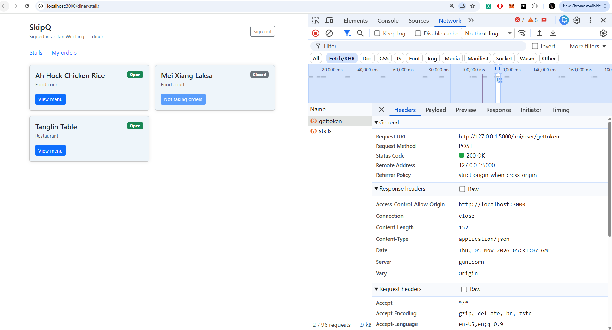

# ICT381 End-of-Course Assessment — July Semester 2026
## Software Engineering and DevOps

| | |
|---|---|
| **Name** | Lau Xing Yao |
| **SUSS PI No.** | B2411711 |
| **Course** | ICT381 Software Engineering and DevOps |
| **Submission date** | 08 November 2026 |
| **Repository** | https://github.com/ICT381/ict381-2026-t02-eca-xxingyao |

### Repository layout

```
/
├── frontend/              React application
├── backend/               Flask API + tests
├── infra/
│   ├── terraform/         Infrastructure as code (Q2)
│   ├── ansible/           Deploy playbooks (Q3b)
│   └── local-ansible/     CI host bootstrap (Q3a)
├── Jenkinsfile            Multibranch pipeline (Q4)
├── evidence/              Run logs and screenshots, by question
└── README.md              This file
```

### Marker's index

| Question | Topic | Marks | Evidence section |
|---|---|---|---|
| 1 | Monorepo migration | 5 | [Q1](#question-1--monorepo-migration) |
| 2a | Terraform authoring | 13 | [Q2a](#question-2a--work-out-and-author-the-terraform) |
| 2b | Terraform run evidence | 6 | [Q2b](#question-2b--run-it-and-capture-the-evidence) |
| 2c | Reflection: current → target | 6 | [Q2c](#question-2c--reflection-current-to-target) |
| 3a | Bootstrap the CI host | 8 | [Q3a](#question-3a--bootstrap-the-ci-host) |
| 3b | Deploy playbooks | 13 | [Q3b](#question-3b--fill-in-and-run-the-two-deploy-playbooks) |
| 3c | Idempotency | 4 | [Q3c](#question-3c--idempotency) |
| 4a | The test gate | 7 | [Q4a](#question-4a--the-test-gate) |
| 4b | Build the release pipeline | 14 | [Q4b](#question-4b--build-the-release-pipeline) |
| 4c | Activate and run the pipeline | 4 | [Q4c](#question-4c--activate-and-run-the-pipeline) |
| 4d | Reflection: the test gate | 3 | [Q4d](#question-4d--reflection) |
| 5 | Operate: reasoning about rollback | 8 | [Q5](#question-5--operate-reasoning-about-rollback) |
| 6 | Reflection: what the monorepo resolved | 9 | [Q6](#question-6--what-the-monorepo-resolved) |

---

# Question 1 — Monorepo migration

**(5 marks)**

### 1. The migrated monorepo

The three codebases were relocated into a single repository:

| Was | Now |
|---|---|
| `myReactApp` (separate repo) | `/frontend` |
| `StaycationX` (separate repo) | `/backend` |
| `automation` (separate repo) | `/infra` |

### 2. Pull request

**PR URL:** `https://github.com/ICT381/ict381-2026-t02-eca-xxingyao/pull/2`

The PR diff is the before/after for items 3 and 4 below.

### 3. Jenkinsfile before/after

Three separate checkouts collapsed into a single monorepo checkout, and stage commands repointed to `/infra`.

| Stage | Before | After |
|---|---|---|
| Checkout | 3 × `git` clone (automation, StaycationX, myReactApp) | `checkout scm` |
| Docker | `ansible-playbook ansible/build-docker.yaml` | `ansible-playbook infra/ansible/build-docker.yaml` |
| Terraform | `terraform -chdir=terraform ...` | `terraform -chdir=infra/terraform ...` |
| Ansible | `ansible-playbook ... ansible/prod-application.yaml` | `ansible-playbook ... infra/ansible/prod-application.yaml` |

### 4. Ansible playbook before/after

| File | Line | Before | After |
|---|---|---|---|
| `infra/ansible/build-docker.yaml` | 35 | `project_src: /opt/StaycationX` | `project_src: /opt/backend` |
| `infra/ansible/build-docker.yaml` | 65 | build context `.../StaycationX/` | build context `.../backend/` (backend image) |
| `infra/ansible/build-docker.yaml` | 79 | build context `.../StaycationX/` | build context `.../backend/` (MongoDB image) |
| `infra/ansible/build-docker.yaml` | 94 | build context `.../myReactApp/` | build context `.../frontend/` |
| `infra/ansible/prod-application.yaml` | 39 | `src: .../StaycationX/dockerhub.yml` | `src: .../backend/dockerhub.yml` |

---

# Question 2 — Infrastructure as code with Terraform

## Question 2a — Work out and author the Terraform

**(13 marks)**

All resources are in [`infra/terraform/main.tf`](infra/terraform/main.tf); the outputs are in [`infra/terraform/output.tf`](infra/terraform/output.tf).

### 1. Committed Terraform configuration

| Resource | File / line | Notes |
|---|---|---|
| CI EC2 instance | `main.tf`, line 152 | `aws_instance.jenkins`, group `jenkins`, `ci_sg` |
| Application EC2 instance | `main.tf`, line 169 | `aws_instance.app`, group `web`, `application_sg` |
| Database EC2 instance | `main.tf`, line 186 | `aws_instance.db`, `database_sg`, no Elastic IP. The default subnet gives it a public IPv4 for outbound traffic only (ECR pulls, apt); inbound is limited by `database_sg` |
| Elastic IP — CI host | `main.tf`, line 206 | `aws_eip.jenkins_eip` |
| Elastic IP — application host | `main.tf`, line 211 | `aws_eip.app_eip` |
| S3 static-website bucket | `main.tf`, line 221 | `awscc_s3_bucket.site` (see note below). Website config line 225, public-access block line 237, public-read policy line 245 |
| ECR repository — backend | `main.tf`, line 263 | `ict381_backend` |
| ECR repository — MongoDB | `main.tf`, line 269 | `ict381_mongo` |

**Why the bucket uses `awscc_s3_bucket`.** The `aws_s3_bucket` resource reads the bucket's Object Lock configuration (`s3:GetBucketObjectLockConfiguration`) after creating it, and the AWS Academy Learner Lab denies that read through a service control policy. The bucket is therefore created with `awscc_s3_bucket` from the `hashicorp/awscc` provider; its website configuration, public-access block and public-read policy are ordinary `aws` provider resources.

### 2. Remote-state backend

S3 backend with `use_lockfile` (Terraform ≥ 1.10), not local state.

- **File:** `main.tf`, lines 1–19 (`backend "s3"` at line 13, `use_lockfile = true` at line 17)
- **State bucket:** `ict381-eca-tfstate-xxingyao-203635632743-us-east-1-an` (created in the AWS Console before `terraform init`)

### 3. Security-group rules enforcing the boundaries

| Boundary | Rule | File / line |
|---|---|---|
| MongoDB 27017 from application SG only | `from_port 27017`, source `application_sg` | `main.tf`, lines 125 and 128 |
| SSH to application host from CI SG only | `from_port 22`, source `ci_sg` | `main.tf`, lines 103 and 106 |
| SSH to database host from CI SG only | `from_port 22`, source `ci_sg` | `main.tf`, lines 132 and 135 |
| Jenkins 8080 from GitHub webhook ranges only | GitHub `hooks` ranges from `api.github.com/meta` | `main.tf`, line 62; IPv4 lines 65–73, IPv6 lines 74–77 |
| Backend API 5000 inbound from internet | `from_port 5000`, `0.0.0.0/0` | `main.tf`, lines 96 and 99 |

The old shared security group (22, 80, 5000, 27017, 8080, 9000 and 3000 open to `0.0.0.0/0`) was removed.

### 4. IAM instance-profile attachments

`iam_instance_profile = "LabInstanceProfile"` on all three hosts — the CI host pushes to S3/ECR through it, and the application and database hosts pull from the private ECR through it.

| Host | File / line |
|---|---|
| CI | `main.tf`, line 157 |
| Application | `main.tf`, line 174 |
| Database | `main.tf`, line 191 |

## Question 2b — Run it and capture the evidence

**(6 marks)**

### 1. Terraform apply output

**Log:** [`evidence/q2b-apply.log`](evidence/q2b-apply.log)

Covers the CI, application and database instances, the Elastic IPs, the S3 website bucket, the private ECR repositories, and the security groups.

### 2. S3 bucket serving the static site

**Screenshot:** [`evidence/q2b-s3-site.png`](evidence/q2b-s3-site.png)


### 3. Terraform output values

**Log:** [`evidence/q2b-output.log`](evidence/q2b-output.log)

| Output | Value | Used by |
|---|---|---|
| `site_website_endpoint` | `ict381-eca-site-xxingyao-203635632743.s3-website-us-east-1.amazonaws.com` | The public site URL |
| `ci_public_ip` | `52.54.76.84` | Q3a SSH, Q4 webhook target |
| `app_public_dns` | `ec2-3-214-100-242.compute-1.amazonaws.com` | Frontend API endpoint |
| `app_private_dns` | `ip-172-31-42-96.ec2.internal` | Ansible/SSH deploy target |
| `site_bucket_name` | `ict381-eca-site-xxingyao-203635632743` | Q4 `aws s3 sync` target |
| `backend_ecr_url` | `203635632743.dkr.ecr.us-east-1.amazonaws.com/ict381_backend` | Q3b/Q4 image pushes |
| `mongo_ecr_url` | `203635632743.dkr.ecr.us-east-1.amazonaws.com/ict381_mongo` | Q3b/Q4 image pushes |
| `db_private_ip` | `172.31.40.21` | Ansible target + backend Mongo endpoint |

## Question 2c — Reflection: current to target

**(6 marks)**

Before = `automation/terraform/` as migrated in Q1 (commit `621a3ef`). After = [`infra/terraform/main.tf`](infra/terraform/main.tf).

### Difference 1 — Two applies and two local states → one config, one remote state

| | |
|---|---|
| **Before** | The same `main.tf` was applied twice: once from my machine for the CI host (Lab 5A), then again by the Jenkins pipeline for the production host (`Jenkinsfile` line 42, `-var="name=prod-ict381" -var="group=web"`). There was no backend block, so each run kept its own local `terraform.tfstate` (one on my machine, one in the Jenkins workspace). |
| **After** | One `main.tf` declares every tier (CI, application, database, S3, ECR) and stores one state in S3 with locking (`backend "s3"` line 13, `use_lockfile = true` line 17). A single `terraform apply` built all 14 resources ([`q2b-apply.log`](evidence/q2b-apply.log)). |
| **Value added** | Reliability, maintainability |
| **Why this is an improvement** | There is one source of truth. Two state files each saw only half the estate, so one run could not see or safely change the other's resources. The state now survives losing my laptop or the Jenkins workspace, the lock file stops two applies from writing the state at the same time, and one plan shows the effect of a change on the whole topology. |

### Difference 2 — Shared wide-open security group → per-tier least-privilege groups

| | |
|---|---|
| **Before** | One group, `jenkins-sg` (old `main.tf` line 26), opened 5000, 22, 80, 27017, 8080, 9000 and 3000 to `var.source_ip_block`, which defaulted to `0.0.0.0/0` (old `variables.tf` line 3). It was attached to both the CI and production hosts. |
| **After** | `ci_sg` (line 51): 22 from anywhere, 8080 from GitHub's webhook ranges only. `application_sg` (line 92): 5000 from the internet, 22 from `ci_sg` only. `database_sg` (line 121): 27017 from `application_sg` only, 22 from `ci_sg` only. Ports 80, 3000 and 9000 are no longer open anywhere. |
| **Value added** | Security |
| **Why this is an improvement** | MongoDB and Jenkins are no longer reachable from the whole internet, and each host opens only the ports its role needs. Rules that reference another group's ID follow group membership rather than IP addresses, so they keep working when instances are replaced. A compromised host no longer has network access to every port on every other host. |

### Difference 3 — 3-in-1 production host → each tier on its own host

| | |
|---|---|
| **Before** | One production EC2 ran the backend (5000), MongoDB (27017) and an nginx container serving React (80) together, deployed with `docker compose` and `dockerhub.yml` (`infra/ansible/prod-application.yaml` lines 37–61). |
| **After** | `aws_instance.app` (line 169) runs only the backend, `aws_instance.db` (line 186) runs only MongoDB, and the frontend is served from S3. The CI host stays separate. |
| **Value added** | Reliability, scalability, security |
| **Why this is an improvement** | A problem in one tier (for example MongoDB using all the memory) can no longer take down the others on the same machine. Each tier can be resized or scaled on its own. Splitting the hosts is also what makes Difference 2 possible: the database can only be limited to "the application host" when it is a separate host. |

### Difference 4 — nginx container for the frontend → S3 static website

| | |
|---|---|
| **Before** | The built React app was served by an nginx container on the production host, on port 80. |
| **After** | An S3 bucket (`awscc_s3_bucket.site`, line 221) with website hosting (line 225, `index.html` as both index and error document) and a public-read policy (line 245). Q4 deploys the build with `aws s3 sync`. |
| **Value added** | Scalability, reliability, maintainability |
| **Why this is an improvement** | S3 serves static files without a server to patch, size or keep running, and it handles load without changes. Frontend releases no longer touch the backend host, and port 80 is no longer needed on any security group. |

### Difference 5 — Docker Hub with stored credentials → private ECR with instance-profile access

| | |
|---|---|
| **Before** | Images were pushed to Docker Hub using a username and password stored in Jenkins (`docker-hub-credentials`, `Jenkinsfile` lines 22–24). |
| **After** | Two private repositories, `ict381_backend` (line 263) and `ict381_mongo` (line 269). The CI, application and database hosts authenticate through `LabInstanceProfile`. |
| **Value added** | Security, maintainability |
| **Why this is an improvement** | No long-lived registry password has to be stored or rotated in Jenkins. Access is controlled by the IAM role attached to each host, and the images are private instead of on a public registry. |

# Question 3 — Automation with Ansible

## Question 3a — Bootstrap the CI host

**(8 marks)**

### (a)(i) Major changes from the base `automation/local-ansible/`

> Compare the provided `infra/local-ansible/` against the base `automation/local-ansible/`. Identify the major changes and explain why each was made: what was removed, what was added, and which files were deleted or renamed.

The provided folder was copied over `infra/local-ansible/`; the commit's diff of that folder shows every change below.

**Files at a glance**

| Base `automation/local-ansible/` | Provided `infra/local-ansible/` | Type |
|---|---|---|
| `application1.yaml` | — | Deleted |
| `gen-gpgkey-ubuntu.yaml` | — | Deleted |
| `application2.yaml` | `jenkins.yaml` | Renamed and rewritten |
| `common.yaml` | `common.yaml` | Modified (cut down) |
| `ansible.cfg`, `inventory` | `ansible.cfg`, `inventory` | Modified |

**What changed and why**

| Change | Type | What changed | Why |
|---|---|---|---|
| App build and deploy on the CI host | Deleted (`application1.yaml`) | Cloned `StaycationX` and `myReactApp` onto the CI host with deploy keys, built the images, pushed them to Docker Hub, and ran the whole app there with `docker compose` and `dockerhub.yml`. | The CI host must not host the application or the database. Images now go to private ECR (Q3b `build-docker.yaml`) and are deployed to the separate application and database hosts by `infra/ansible/`. One monorepo also replaces the two separate repos. |
| GPG key and `pass` credential store | Deleted (`gen-gpgkey-ubuntu.yaml`) | Generated a GPG key and set up `pass` so Docker could store the Docker Hub password. | Docker Hub is replaced by ECR, which the CI host reaches through `LabInstanceProfile`. With no registry password to store, the credential store, `pass`, `rng-tools`, the credential helper and the `juju4.gpgkey_generate` role are all removed. |
| Secrets and GitHub deploy keys | Removed (`common.yaml`) | Loading `GITHUB_PAT` and the Docker Hub login from `secrets.yaml`, generating a deploy key per repo, and uploading them to GitHub. | There's no Docker Hub login and one monorepo. In Q3b the CI host clones it over HTTPS with a read-only fine-grained token, so no secrets file or deploy keys are needed. |
| Terraform on the CI host | Removed (`application2.yaml` → `jenkins.yaml`) | The HashiCorp repository and the `terraform` install. | Terraform now runs once, locally, from one config (Q2). The pipeline no longer provisions infrastructure. |
| AWS CLI v2 | Added (`common.yaml`) | Downloads and installs AWS CLI v2, each step guarded with `creates:`. | The CI host needs `aws` for ECR login and `aws ecr list-images` (Q3b) and `aws s3 sync` (Q4). The guards make reruns skip these steps. |
| Docker install and docker groups | Changed / added (`common.yaml`, `jenkins.yaml`) | Installs `docker-ce`, `docker-ce-cli`, `containerd.io` and `docker-compose-plugin` with `state: present` (was `docker-ce` with `state: latest`). Adds both `ubuntu` and `jenkins` to the `docker` group. | The compose plugin is needed for `docker compose` (Q4 test harness). `ubuntu` runs Docker in the Q3b build and `jenkins` runs it in the Q4 pipeline, without `sudo`. `state: present` doesn't upgrade on every rerun. |
| SSH key on the CI host | Added (`common.yaml`, `jenkins.yaml`) | Copies `labsuser.pem` to `/home/ubuntu` and `/var/lib/jenkins`, each owned by that user, mode `0400`. | The application and database hosts only accept SSH from the CI host, so Ansible deploys from there: `ubuntu` for the manual Q3b run, `jenkins` for the Q4 pipeline. |
| Guarded reboot | Changed (`jenkins.yaml`) | Base rebooted on every run. Now it only reboots `when:` the `jenkins` docker-group change actually happened. | The reboot is only needed once. Guarding it, together with `state: present` and the `creates:` guards, keeps a second run at `changed=0` (Q3c idempotency). |
| Connection settings | Changed (`ansible.cfg`, `inventory`) | Added `host_key_checking = False` and pinned `interpreter_python = /usr/bin/python3`. The inventory now names the host directly: `ci ansible_host=<Elastic IP> ansible_user=ubuntu`. | The CI host can be rebuilt, which changes its SSH host key and would otherwise block the bootstrap. Its Elastic IP from Q2 is stable, so the inventory can point at it directly. |

### (a) Bootstrap run

**Log:** [`evidence/q3a-bootstrap.log`](evidence/q3a-bootstrap.log) — `ansible-playbook common.yaml jenkins.yaml`

Both plays finished with `failed=0` (final `PLAY RECAP`: `ci : ok=20 changed=17 unreachable=0 failed=0`).

### (a) Bootstrap proof

**Log:** [`evidence/q3a-verify.log`](evidence/q3a-verify.log)

| Check | Result |
|---|---|
| Docker version | `Docker version 29.9.2, build a82e528` |
| Ansible version | `ansible [core 2.21.5]` |
| AWS CLI version | `aws-cli/2.39.3` |
| `labsuser.pem` present on host | `-r-------- 1 ubuntu ubuntu 1674 … /home/ubuntu/labsuser.pem` |
| Jenkins on 8080 (`X-Jenkins` header) | `HTTP/1.1 403 Forbidden` with `X-Jenkins: 2.580.2` (403 is expected before login) |

The Jenkins check uses `curl -sI http://localhost:8080 | grep -iE "^HTTP|^X-Jenkins"` instead of `| head -5`, because Jenkins sends the `X-Jenkins` header after its security headers, outside the first five lines.

## Question 3b — Fill in and run the two deploy playbooks

**(13 marks)**

### (b) Completed files

| File | What was filled in |
|---|---|
| [`infra/ansible/build-docker.yaml`](infra/ansible/build-docker.yaml) | Build-and-push tasks in the `YOUR SCRIPT` block: build and push the backend image, then build the MongoDB image from `backend/DockerfileMongo` and push it, each tagged `{{ image_tag }}` (default `latest`) |
| [`infra/ansible/inventory.ini`](infra/ansible/inventory.ini) | `[app]` → `ip-172-31-42-96.ec2.internal`, `[db]` → `172.31.40.21`, and the backend and MongoDB ECR repository URLs, all from the Q2 `terraform output` |
| [`infra/ansible/prod-application.yaml`](infra/ansible/prod-application.yaml) | MongoDB play → `hosts: db`, backend play → `hosts: app`, and `image_tag: latest` as the default |

`ansible.cfg` and the two compose templates under `templates/` are unchanged from the provided files.

**Backend files the build needs.** This repo uses my SkipQ TMA backend, which had no Dockerfiles, so `build-docker.yaml` had nothing to build from `backend/`. I added:

| File | Why |
|---|---|
| [`backend/Dockerfile`](backend/Dockerfile) (new) | Builds the API image (`python:3.12-slim`, `gunicorn` on port 5000) and sets `MONGODB_HOST=db` so the backend uses the `db` name mapped by `extra_hosts` |
| [`backend/DockerfileMongo`](backend/DockerfileMongo), [`backend/db_seed_restore.sh`](backend/db_seed_restore.sh) | The provided files, unchanged |
| [`backend/db_seed/skipq/`](backend/db_seed/skipq) | A `mongodump` of the database produced by my existing `db_seed/seed.py`, in the dump format `mongorestore --drop /opt` expects |

### (b) Run logs

| Log | What it proves |
|---|---|
| [`evidence/q3b-build-push.log`](evidence/q3b-build-push.log) | Both images built and pushed to private ECR (`changed=4 failed=0`) |
| [`evidence/q3b-ecr-images.log`](evidence/q3b-ecr-images.log) | `aws ecr list-images` lists the pushed image in both `ict381_backend` and `ict381_mongo` |
| [`evidence/q3b-deploy.log`](evidence/q3b-deploy.log) | The split deploy ran across both hosts (`application` and `database`: `changed=9 failed=0`) |

### (b) Service verification

**Log:** [`evidence/q3b-verify.log`](evidence/q3b-verify.log)

The verification commands are the paper's, adapted to my database name (`skipq` instead of `staycation`).

| Check | Expected | Result |
|---|---|---|
| `docker ps` on database host | MongoDB container running | `mongo-db-1` running `ict381_mongo:latest`, port 27017 |
| `appUsers` count | Greater than 0 — proves first-start seeding | `appUsers count: 5` (3 vendors, 2 diners) |
| `docker ps` on application host | Backend container running | `backend-backend-1` running `ict381_backend:latest`, port 5000 |
| Backend `extra_hosts` mapping | `db` → database host private address | `[db:172.31.40.21]` |
| Backend log | Started cleanly | `gunicorn` listening at `http://0.0.0.0:5000`, worker booted, no errors |
| `curl` application host :5000 | Any HTTP response | `HTTP/1.1 404 NOT FOUND` with the app's own `{"error":"No such endpoint"}` (no route at `/`) |
| Login `curl` (additional proof) | Backend reads `appUsers` across hosts | `HTTP/1.1 200 OK` with a token for `Tan Wei Ling`, role `Diner` |

The extra login check is there because my backend connects to MongoDB on the first request, not at start-up, so its log alone cannot show the connection.

### (b) Question 1 — Why does the backend container need the `db` `extra_hosts` mapping?

> Why does the backend need this in the split deployment, when the original co-located `dockerhub.yml` did not?

**How my backend finds MongoDB.** `app/__init__.py` loads `Config` from `app/config.py`, which reads the host from the `MONGODB_HOST` environment variable (default `127.0.0.1`). It is not tied to `FLASK_ENV=development`: it can be set in any environment. My `backend/Dockerfile` sets `MONGODB_HOST=db`, so the container always looks for a host called `db`.

**How the old single-host setup resolved `db`.** In the co-located `dockerhub.yml`, the backend, MongoDB and Nginx were services in one Docker Compose project on one host. Compose puts them on a shared network with built-in DNS, so the service name `db` resolved to the MongoDB container automatically.

**What changed.** MongoDB now runs in a separate Compose project on a separate EC2 host. The backend's project on the application host has no `db` service, so Docker's DNS cannot resolve the name and the connection would fail. `extra_hosts` in `templates/backend-compose.yml.j2` adds `db → 172.31.40.21` (the database host's private address, from the inventory) to the container's `/etc/hosts`. The verify log confirms it: `[db:172.31.40.21]`. The backend then connects over the private network, which is what `database_sg` allows (27017 from `application_sg` only), with no code change.

### (b) Question 2 — Why is the AWS CLI installed on the application and database hosts?

The setup play in `prod-application.yaml` installs the AWS CLI so each host can run `aws ecr get-login-password | docker login` against the private ECR registry (the "Authenticate Docker to the private ECR" task). The CLI gets a temporary token from `LabInstanceProfile`, so no password is stored anywhere.

It must be on those two hosts because they are the ones that pull the images: `docker compose` on the database host pulls `ict381_mongo`, and on the application host it pulls `ict381_backend`. A `docker login` is per host. The CI host's login does not carry over, and because the repositories are private, a host that has not logged in cannot pull.

### (b) Question 3 — What each verification command checks

| Command | What it checks | Why it matters for confirming the split deploy |
|---|---|---|
| `docker ps` (database host) | The MongoDB container from `ict381_mongo:latest` is up | Proves the database tier was pulled from ECR and is running on its own host |
| `mongosh` appUsers count | The `skipq` database has user accounts (5) | Proves the image seeded itself on first start from the baked-in dump, so logins will work |
| `docker ps` (application host) | The backend container from `ict381_backend:latest` is up on 5000 | Proves the backend tier was pulled from ECR and is running on a separate host from MongoDB |
| `docker inspect` extra_hosts | `db` maps to `172.31.40.21` | Proves the name the backend uses points at the database host's private address — the link between the two hosts |
| `docker logs` backend | `gunicorn` started and is listening on `0.0.0.0:5000` without errors | Proves the backend process is healthy, not crash-looping |
| `curl` :5000 | The API answers from outside the host (404 from the app itself) | Proves port 5000 is open in `application_sg` and the backend is serving, which is how the browser will reach it |

## Question 3c — Idempotency

**(4 marks)**

### (c) Idempotency log

**Log:** [`evidence/q3c-idempotency.log`](evidence/q3c-idempotency.log)

The log holds the second run of the deploy and the later runs of the bootstrap.

```
# Deploy, second run (ansible-playbook prod-application.yaml)
application : ok=10 changed=0 unreachable=0 failed=0 skipped=1
database    : ok=10 changed=0 unreachable=0 failed=0 skipped=1

# Bootstrap, third run (ansible-playbook common.yaml jenkins.yaml)
ci          : ok=12 changed=0 unreachable=0 failed=0 skipped=1
ci          : ok=18 changed=0 unreachable=0 failed=0 skipped=2
```

The bootstrap's second run reported `changed=2`. Both were `common.yaml`'s "Download the AWS CLI v2 installer" and "Unpack the AWS CLI v2 installer", which write to `/tmp`. The first run's guarded reboot (in `jenkins.yaml`) emptied `/tmp`, so the `creates:` checks found nothing and the files were fetched again; the install itself was skipped because `/usr/local/bin/aws` already existed. With no reboot in between, the third run reported `changed=0`.

### (c) Why the idempotent deploy matters

Q4's pipeline runs `prod-application.yaml` on every merge to `main`, and Q5's rollback runs the same playbook with an older `-e image_tag`. An idempotent deploy only changes what is different. When nothing changed, the run reports `changed=0` and leaves both hosts alone; when only the backend tag changed, only the backend container is recreated.

If the deploy tore everything down and rebuilt it every time, each merge would restart the backend and cause downtime even with no change. It would also tear down the MongoDB container. My `mongo-compose.yml.j2` declares no named volume, so a fresh container starts with an empty data directory and re-seeds itself, wiping every order and account created in production since the last deploy. For a rollback, idempotency means only the backend image changes, so the rollback is quick and predictable and does not touch the database.


---

# Question 4 — Continuous integration and delivery

## Question 4a — The test gate

**(7 marks)**

### (a)(i) Completed test harness

**File:** [`backend/test-compose.yml`](backend/test-compose.yml) — every `REPLACE_WITH_...` placeholder resolved.

| Service | Purpose | Key configuration |
|---|---|---|
| `db` | Seeded MongoDB built from `DockerfileMongo` | Named `db`, the host name the test container is pointed at; the provided healthcheck holds the tests until Mongo answers `ping` |
| `test` | `python:3.12`, backend source mounted at `/skipq` (`working_dir: /skipq`, volume `.:/skipq`) | Runs `sh -c "pip install -r requirements.txt && MONGODB_HOST=db python -m pytest -vv tests/unit tests/functional"`; `depends_on: db` with `condition: service_healthy` |

**Adapted for SkipQ.** StaycationX hard-codes the Mongo host `db`. My backend reads it from `MONGODB_HOST` in `app/config.py` (default `127.0.0.1`), so the test command sets `MONGODB_HOST=db` inline — no extra keys added to the scaffold and no code change.

**Frontend changes needed for the suite to run** (on this branch):

- [`frontend/src/domain/orderActions.test.js`](frontend/src/domain/orderActions.test.js) — new. My TMA frontend had no tests, and `CI=true npm test` exits with "No tests found". It tests `actionsFor()` and includes one deliberately failing test (as the paper asks for the TMA option), fixed in part (c).
- [`frontend/package.json`](frontend/package.json) / [`frontend/package-lock.json`](frontend/package-lock.json) — `npm ci` refused to install because the lock file was out of sync (it listed the three `@testing-library` packages that `package.json` did not, and pinned `typescript@7.0.2`, which `react-scripts` 5's optional peer range does not accept). I restored the three packages, pinned `typescript` to `4.9.5`, and regenerated the lock file inside `node:16.20.2-alpine`, the same Node the gate uses.

### (a)(ii) Both suites run

| Log | Suite | Result |
|---|---|---|
| [`evidence/q4a-frontend.log`](evidence/q4a-frontend.log) | React suite in `node:16.20.2-alpine` (`npm ci && CI=true npm test`) | `Tests: 1 failed, 3 passed, 4 total` — the failure is the deliberate one |
| [`evidence/q4a-backend.log`](evidence/q4a-backend.log) | `tests/unit` + `tests/functional` against the seeded Mongo (`docker compose -f test-compose.yml up --build --abort-on-container-exit --exit-code-from test`) | `1 failed, 94 passed`, `test-1 exited with code 1` — see Question 3 below |

Both suites ran to completion and reported red, which is expected here; the red → green transition is demonstrated in part (c).

### (a) Question 1 — Why does the backend test run need a MongoDB at all?

My backend has no in-memory or mocked data layer: every endpoint reads and writes through MongoEngine models stored in MongoDB (`appUsers`, `foodItems`, `foodOrders`, `payments`, `notifications`, `tokens`). The functional suite (`tests/functional/test_api.py`) calls those endpoints through Flask's test client — logging in with `/api/user/gettoken`, placing and moving orders, reading the vendor dashboard — so each test needs a real database to read the accounts and orders from and to write the results back to. Without one, MongoEngine's connection times out after `MONGODB_TIMEOUT_MS` (2 s) and every functional test errors.

The unit suite (`tests/unit/test_order_rules.py`) checks the order-status rules with `unittest.mock.Mock` objects and does not touch the database; the MongoDB is there for the functional tests, which cover the paths the browser actually uses.

### (a) Question 2 — Why does the test gate need the database seeded with the SkipQ data?

The functional tests assert exact values from known data, not just that an endpoint answers. For example, `test_the_dashboard_excludes_refunded_and_rejected_takings` expects `order_count == 8` and `total_takings == 62.5` for one stall, and the `auth` fixture logs in with seeded accounts such as `weiling@skipq.test` / `Password1!`. On an empty database the logins would return `401` and every count would be zero, so the tests could not tell a correct backend from a broken one.

In my build both seeds come from the same source, `db_seed/seed.py`: the `db` image restores a `mongodump` of it into the `skipq` database on first start (the provided `DockerfileMongo` / `db_seed_restore.sh`), and the `seeded` fixture in `tests/conftest.py` runs `seed()` into the separate `skipq_test` database before the tests and drops it afterwards. So the tests always start from the same known state, and a test run can never alter the data the deployed app is built from.

### (a) Question 3 — One improvement to the backend testing in this gate

**Make the date-dependent tests independent of the time they run.** The one backend failure in [`q4a-backend.log`](evidence/q4a-backend.log) is `test_the_dashboard_excludes_refunded_and_rejected_takings` (`assert 7 == 8`). It is not a code fault: the vendor dashboard counts only orders created *today* in UTC (`app/models/order.py`, the day range built from `datetime.utcnow().date()`), while `db_seed/seed.py` creates orders up to 300 minutes old. I ran the suite at 04:26 UTC, so the 300-minute-old order was dated the previous UTC day and dropped out of the count. The test therefore fails every day between 00:00 and 05:00 UTC (08:00–13:00 Singapore time) and passes otherwise.

In a gate that decides whether a release ships, a test that fails by the clock blocks good merges for five hours a day and teaches people to re-run until green, which hides real failures. The fix is to make time an input rather than a side effect: let the dashboard accept the day it reports on (the model's day-range helper already takes an optional `day`), or have the seed place its orders relative to the start of the current UTC day instead of "minutes ago". Either way the expected `order_count` is the same whenever the gate runs.

## Question 4b — Build the release pipeline

**(14 marks)**

### (b) The completed pipeline file

**File:** [`Jenkinsfile`](Jenkinsfile) — every `REPLACE_WITH_` filled.

| Blank | What it achieves | Value used |
|---|---|---|
| `SITE_BUCKET` (line 19) | Q2 output — S3 sync target | `ict381-eca-site-xxingyao-203635632743` |
| `APP_PUBLIC_DNS` (line 20) | Q2 output — frontend API base | `ec2-3-214-100-242.compute-1.amazonaws.com` |
| Tag release (lines 59–60) | Tags the merged commit with the machine-generated `RELEASE_TAG` (`v${BUILD_NUMBER}`) and pushes the tag, using the SSH push credential | `sshagent(['github-ssh-key'])` around `git tag ${RELEASE_TAG} && git push origin ${RELEASE_TAG}` |
| Deploy frontend to S3 (line 77) | Publishes the build to the public website bucket through the CI host's instance profile, removing files no longer in the build | `aws s3 sync build/ s3://${SITE_BUCKET} --delete --region ${AWS_REGION}` |
| Deploy backend (lines 88, 92) | Builds and pushes the immutable `:vN` images to ECR with the Q3(b) playbook, then deploys that same tag to both hosts with the Q3(b) deploy playbook | `ansible-playbook build-docker.yaml -e backend_repo=…/ict381_backend -e mongo_repo=…/ict381_mongo -e image_tag=${RELEASE_TAG}`, then `ansible-playbook prod-application.yaml -e image_tag=${RELEASE_TAG} -e mongo_image_tag=${RELEASE_TAG}` |
| `main`-only guards (lines 55, 66, 83) | Run the three deploy stages only on the `main` build | `when { branch 'main' }` on Tag release, Deploy frontend to S3 and Deploy backend to app host |

### (b) The frontend API base

**Adapted for SkipQ.** The five StaycationX files (`form.js`, `show.js`, `manage.js`, `explore.js`, `book.js`) do not exist in my TMA frontend. Every SkipQ page sends its requests through `src/api/endpoints.js`, which calls one module, [`frontend/src/api/client.js`](frontend/src/api/client.js). That module already reads the API base from the build-time variable (line 3):

```javascript
const BASE_URL = process.env.REACT_APP_API_URL || 'http://127.0.0.1:5000';
```

So the change the paper asks for — replace the `window.location.hostname` base with `process.env.REACT_APP_API_URL` — is already in place, in one file instead of five, and needed no edit.

### (b) Local development still works

**Screenshot:** [`evidence/q4b-local-dev-network.png`](evidence/q4b-local-dev-network.png)



`npm start` on `localhost:3000` signing in through `POST http://127.0.0.1:5000/api/user/gettoken` (`200 OK`), then loading `stalls`, from the local `docker compose` backend. The backend's CORS response (`Access-Control-Allow-Origin: http://localhost:3000`) allows the cross-origin call. My backend had no compose file, so I added [`backend/docker-compose.yml`](backend/docker-compose.yml): the API built from `backend/Dockerfile` and published on `5000`, plus the seeded MongoDB from `DockerfileMongo`.

### (b) Write-up 1 — The local-development fix

> The replacement line works for the deployed build but breaks local development. Modify the change so local dev still works while still using the injected value for the deployed build, and explain the approach.

**Approach: an injected value with a local fallback.** `client.js` uses `process.env.REACT_APP_API_URL || 'http://127.0.0.1:5000'`.

- **Deployed build.** The pipeline's `Deploy frontend to S3` stage runs `npm run build` with `-e REACT_APP_API_URL=http://${APP_PUBLIC_DNS}:5000`. `react-scripts` replaces `process.env.REACT_APP_API_URL` with that string when it builds the bundle, so the site served from S3 calls the application host.
- **Local development.** `npm start` runs without the variable, so the expression is `undefined || 'http://127.0.0.1:5000'` and the dev server on `:3000` calls the backend that `docker compose up` publishes on `:5000`.

The bare replacement line breaks local development because, with nothing injected, the URL becomes `undefined` and every request fails. The fallback keeps one code path for both cases with no branching on environment, and a developer can still point at another backend by setting the variable in `frontend/.env` (the template is in `frontend/.env.example`). Because every page uses `client.js`, the rule lives in one place.

### (b) Write-up 2 — The frontend build command explained

```
docker run --rm -e REACT_APP_API_URL=http://${APP_PUBLIC_DNS}:5000 \
  -v "$PWD:/app" -w /app node:16.20.2-alpine sh -c "npm ci && npm run build"
```

| Part | What it does | Why |
|---|---|---|
| `docker run --rm` | Runs the build in a new container and deletes the container when it exits | The CI host has no Node installed (Q3(a) installs Docker, Ansible, the AWS CLI and Jenkins, but not Node), and a throwaway container leaves nothing behind between builds |
| `-e REACT_APP_API_URL=…` | Sets the API base inside the container to the application host's public DNS on port 5000 | `react-scripts` bakes `REACT_APP_*` variables into the JavaScript at build time; a static site on S3 has no server to read them at run time, so the value must be set here. `APP_PUBLIC_DNS` is the Elastic IP's DNS from Q2, so it stays valid across restarts |
| `-v "$PWD:/app"` | Mounts the Jenkins workspace's `frontend/` folder into the container at `/app` | The build writes `build/` back to the host, where the next step (`aws s3 sync build/ …`) uploads it with the CI host's instance profile |
| `-w /app` | Starts the command in `/app` | That is where `package.json` and `package-lock.json` are, so `npm` finds the project |
| `node:16.20.2-alpine` | A pinned Node 16 image | The same image as the frontend test stage, so the code is built with exactly the Node it was tested on. My lock file was regenerated under this Node (Q4a) so `npm ci` succeeds here; `alpine` keeps the image small |
| `npm ci` | Clean-installs exactly the versions in `package-lock.json` | Every build gets the same dependency tree, and the step fails instead of silently drifting if `package.json` and the lock file disagree |
| `npm run build` | Runs `react-scripts build`, producing an optimised static site in `build/` | This is the folder the S3 sync publishes, with the API base already inlined |

### (b) Write-up 3 — Why the `main`-only guard is on the deploy stages only

`Checkout`, `Frontend tests` and `Backend tests` are deliberately unguarded because they are the gate, and the gate has to run on every branch. A push to `feat/q4-cicd` must check out the code and run both suites so Jenkins can post the ✓/✗ check on the pull request — that check is what tells me whether the PR may be merged. Guarding the tests would mean feature branches reported nothing, and untested code could reach `main`.

The three deploy stages change shared, live state, so they must run only for the reviewed, merged code on `main`:

- **Tag release** writes a permanent tag to GitHub. A Multibranch job numbers builds separately per branch, so without the guard a feature branch's build #1 and `main`'s build #1 would both try to push `v1`, and a release tag could point at unmerged work.
- **Deploy frontend to S3** overwrites the public site (`--delete` even removes files), and **Deploy backend to app host** replaces the containers users are hitting. Running either from a feature branch would ship work-in-progress code to production before review.

With the guards, a feature-branch build runs the gate and stops; only a green `main` build tags and deploys.

## Question 4c — Activate and run the pipeline

**(4 marks)**

### (c) The tagged release

**Screenshot:** [`evidence/q4c-github-tags.png`](evidence/q4c-github-tags.png)

Release tag pushed: **`v3`**, on merge commit `337784e` ("Merge pull request #3 from ICT381/feat/q4-cicd"). Pushed by the **Tag release** stage of Jenkins build `main #3`, `RELEASE_TAG = "v${BUILD_NUMBER}"`.

### (c) The live site, logged in end to end

**Screenshot:** [`evidence/q4c-live-site-login.png`](evidence/q4c-live-site-login.png)

Single screenshot showing all three:
- [x] Browser address bar with the S3 website URL `http://ict381-eca-site-xxingyao-203635632743.s3-website-us-east-1.amazonaws.com`
- [x] The "Log In" heading (the Q4 UI change — proves this is *this* pipeline's release, not the Q3b deploy). SkipQ's sign-in page heading was `SkipQ`; commit `ab9ee71` changed it to `Log In` in `frontend/src/Pages/SignIn.js`.
- [x] Network tab: `POST http://ec2-3-214-100-242.compute-1.amazonaws.com:5000/api/user/gettoken` at **status 200** (`Server: gunicorn`, `Access-Control-Allow-Origin` = the S3 website origin)

### (c) Webhook

**Screenshot:** [`evidence/q4c-webhook.png`](evidence/q4c-webhook.png)

Webhook at `http://52.54.76.84:8080/github-webhook/`, content type `application/json`, subscribed to **Pushes** and **Pull requests**. Recent Deliveries shows the `push` delivery of `feat/q4-cicd` at 16:34:42 with **Response 200**, which started Jenkins build `feat/q4-cicd #1`.

### (c) The pipeline stood up

| Screenshot | Shows |
|---|---|
| [`evidence/q4c-job-config.png`](evidence/q4c-job-config.png) | Multibranch job `ict381-eca`: GitHub branch source `https://github.com/ICT381/ict381-2026-t02-eca-xxingyao.git` with the fine-grained token; behaviours *Discover branches* (exclude branches also filed as PRs), *Discover pull requests from origin* (current PR revision), *Checkout over SSH* (`github-ssh-key`); build by `Jenkinsfile` |
| [`evidence/q4c-credentials.png`](evidence/q4c-credentials.png) | `github-ssh-key` (SSH username with private key, user `git`, GitHub deploy key with write access) and `github-token` (fine-grained GitHub token) |

The `jenkins` user's `known_hosts` holds GitHub's host keys (`ssh-keyscan github.com`), so checkout and the tag push verify the host key.

The GitHub Classroom *Feedback* pull request (#1, head `main`) was closed while the pipeline ran. With *Exclude branches that are also filed as PRs*, an open PR whose head is `main` hides `main` from branch discovery, so `main` would never build or deploy. It was reopened afterwards.

### (c) The gate is causal — red → green → merge → deploy

| Step | Evidence | Screenshot |
|---|---|---|
| 1. Push with failing test → red build, PR ✗ | `feat/q4-cicd` pushed with the Q4a test still expecting `'Refunded'`. Jenkins `feat/q4-cicd #1` and the PR build for PR #3 fail at **Frontend tests** (`Expected: "Refunded"`, `Received: "Refund"`, 1 failed / 3 passed); Backend tests, Tag release and both Deploy stages are skipped. PR #3 shows `continuous-integration/jenkins/pr-head` ✗. | [`q4c-gate-red.png`](evidence/q4c-gate-red.png) |
| 2. Fix in a second commit → green, PR ✓ | Commit `ab9ee71` changes the assertion to `'Refund'` (and the heading to `Log In`). The PR build re-runs both suites: `pr-head` ✓ "This commit looks good". | [`q4c-gate-green.png`](evidence/q4c-gate-green.png) |
| 3. Merge after the green check | PR #3 merged as `337784e` only after the ✓; the commit list shows `ebb99d6` ✗ then `ab9ee71` ✓. | [`q4c-gate-merge.png`](evidence/q4c-gate-merge.png) |
| 4. Gate re-runs on `main`, then deploy stages run | `main #3`: Checkout → Frontend tests → Backend tests → Tag release (`v3`) → Deploy frontend to S3 → Deploy backend to app host, all green (4 min 35 s). | [`q4c-gate-deploy.png`](evidence/q4c-gate-deploy.png) |

No red pull request was merged at any point.

`main #2`, the first build of the merge commit, failed at **Backend tests** with `Conflict. The container name "/backend-db-1" is already in use`. When PR #3 closed, `feat/q4-cicd` became a plain branch again and built at the same moment. Both builds ran `test-compose.yml` from a directory named `backend`, so they shared the Compose project name and container names. The gate still held: Tag release and both Deploy stages were skipped. `main #3` re-ran the same commit with no concurrent build and passed. (See Q4d.)

### (c) Why the SSH-tunnelled Jenkins access is secure

> You reach the Jenkins UI over an SSH tunnel instead of opening port 8080 to the internet. What makes this access path secure — what protects it, and which attack surface does it remove?

**What protects it.** The UI is reached with `ssh -i labsuser.pem -L 8080:localhost:8080 ubuntu@52.54.76.84`, then `http://localhost:8080`.
- **Authentication:** the SSH server on the CI host accepts only the `vockey` key pair. Only the holder of the private key can open the tunnel. A password guess or a scan of port 22 gets nothing.
- **Encryption and integrity:** Jenkins itself serves plain HTTP. Inside the tunnel, the Jenkins admin password, the session cookie and every page (credential IDs, build logs) travel encrypted, so nobody on the path can read or alter them.
- **Host verification:** SSH checks the CI host's host key, so a man-in-the-middle cannot pose as the CI host.

**What attack surface it removes.** In `ci_sg`, port 8080 is open only to GitHub's published webhook ranges (`192.30.252.0/22`, `185.199.108.0/22`, `140.82.112.0/20`, `143.55.64.0/20`, …), not to `0.0.0.0/0`. So the Jenkins login page, the script console and the Jenkins CLI endpoint cannot be reached from the internet. That rules out:
- password brute-forcing of the admin account;
- unauthenticated exploits against Jenkins itself, e.g. CVE-2024-23897, where the built-in CLI let unauthenticated attackers read arbitrary files on the controller (Jenkins Security Advisory 2024-01-24);
- sniffing the admin session over unencrypted HTTP.

This matters because the CI host is the most privileged machine in the system. It holds the GitHub deploy key with **write** access (it pushes release tags), its instance profile can push to ECR and overwrite the S3 site, and it can SSH into the app and DB hosts. A compromised Jenkins means a compromised production.

**What remains.** Port 22 is still open to `0.0.0.0/0` (Learner Lab IPs change between sessions), so it relies on key-only authentication. It could be tightened to the operator's own IP, or replaced with AWS Systems Manager Session Manager port forwarding so no inbound port is needed at all.

References: [Jenkins Security Advisory 2024-01-24 (CVE-2024-23897)](https://www.jenkins.io/security/advisory/2024-01-24/) · [GitHub meta API — webhook IP ranges](https://api.github.com/meta) · [OpenSSH `ssh -L` local forwarding](https://man.openbsd.org/ssh#L)

## Question 4d — Reflection

**(3 marks)**

### (d)(a) Against change-scoped testing

> A teammate argues the gate is wasteful: when a PR touches only `/frontend`, run the React suite alone; when it touches only `/backend`, run the backend suite alone. Counter this.

**Context.** SkipQ is one product kept in two directories, and it is released as one unit. Every green `main` build creates **one** tag (`RELEASE_TAG = "v${BUILD_NUMBER}"`, e.g. `v3`) and runs **both** deploy stages, whichever directory the pull request touched:
- `aws s3 sync build/ s3://${SITE_BUCKET} --delete` publishes the frontend;
- `build-docker.yaml -e image_tag=${RELEASE_TAG}` followed by `prod-application.yaml -e image_tag=${RELEASE_TAG} -e mongo_image_tag=${RELEASE_TAG}` rebuilds and redeploys the backend and MongoDB.

So the gate does not certify a diff. It certifies the release that is about to ship, and that release always contains both tiers.

**Why both suites run on every change:**

1. **A "frontend-only" PR still ships a freshly built backend.** The Deploy backend stage rebuilds the backend and MongoDB images for every tag. Their bases are not frozen: `backend/DockerfileMongo` is `FROM mongo` (i.e. `latest`), `backend/Dockerfile` is `FROM python:3.12-slim`, and the test service in `backend/test-compose.yml` is `python:3.12`. If PR #3 had touched only `/frontend`, `v3` would still have carried a MongoDB image pulled that day. The backend suite (`tests/unit` and `tests/functional`, run against the seeded `DockerfileMongo` database) is the only check on that image before it reaches the database host. Skipping it would put an untested backend under a release tag that claims to be tested.
2. **The two suites guard two halves of one rule.** `frontend/src/domain/orderActions.js` says *"The backend owns the rule; this mirrors only the question of what to show"*. It hard-codes the backend's status names (`PendingAcceptance`, `Rejected` → `Refunded`, `NoShow`), `NO_SHOW_AFTER_MINUTES = 30`, and the naive-UTC `status_updated_at` format. The backend half is pinned by `backend/tests/unit/test_order_rules.py` (`test_the_table_permits_every_move_it_declares`, `test_no_show_is_refused_inside_the_window`, …), and the frontend half by `orderActions.test.js`. A "backend-only" change to the order table is really a change to both tiers. Running both suites on the same commit re-asserts both halves together, instead of checking one side against an old build of the other.
3. **In this repo, path filters would miss the changes that matter most.** Many changes live in neither directory: `Jenkinsfile`, `infra/ansible/*.yaml`, `infra/terraform/`. PR #3 itself touched `Jenkinsfile`, `backend/`, `frontend/` and `README.md`. A path filter would either run nothing for a `Jenkinsfile` or Ansible change (exactly the changes that alter how the build tests and deploys) or need a hand-maintained list that can drift.
4. **The saving is small and the risk is not.** `main #3` ran both suites, tagged and deployed in **4 min 35 s**, and most of the frontend time is `npm ci`. A bad release, by contrast, means rolling back the S3 site, the ECR images and the app host.

Change-scoped testing makes sense where each directory deploys independently and a build graph (Nx, Bazel) knows the dependencies. Here every release deploys both tiers. Scoping the *tests* while the *deploy* stays whole is exactly the mismatch the teammate's proposal would create.

### (d)(b) Against testing once

> The gate runs the whole suite on every feature-branch push, then again on the `main` build before the deploy stages. Explain why the second run is not redundant.

1. **The PR build does not test the commit that is released.** In the job configuration, *Discover pull requests from origin* uses **"The current pull request revision"**. Jenkins builds the PR **head** (`ab9ee71`) and reports it as `continuous-integration/jenkins/pr-head`. The commit that was tagged `v3` and deployed is the **merge commit `337784e`**, which no build had seen until `main` built it. If `main` moves after a branch is cut, two pull requests that are each green can combine into a red `main`. For example, one renames a status in `backend/app/models/order.py` while the other adds a frontend action for the old name in `orderActions.js`. Only the `main` run tests the merged tree.
2. **It tests the exact inputs the release is built from, at the moment it is built.** The `main` build checks out `337784e`, runs the gate, then tags that commit and builds the S3 bundle and the `v3` images from it. Between the PR run and the merge, the inputs outside Git can change:
   - `FROM mongo` resolves to whatever `latest` is that day;
   - `npm ci` downloads from the registry again;
   - the clock moves on. The backend dashboard test counts today's UTC orders and fails between 00:00 and 05:00 UTC (see Q4a(3)).

   A green check from earlier is evidence about a different moment.
3. **It is the last guard right before the irreversible steps.** **Tag release** pushes a permanent tag. **Deploy frontend to S3** overwrites the live site with `--delete`. **Deploy backend to app host** replaces the running containers. `main #2` shows this guard at work. It was the first build of merge commit `337784e`, and it failed at **Backend tests** (`Conflict. The container name "/backend-db-1" is already in use`, caused by a `feat/q4-cicd` build running at the same moment). Tag release and both Deploy stages were skipped, so no `v2` tag exists and production stayed on the previous release. The earlier feature-branch run was already green and could not have stopped that.

**What this taught me about the gate.** Concurrent builds on the CI host share the Compose project name `backend`, taken from the directory name, so they can break each other. Giving each run its own project would fix this, e.g. `docker compose -p "skipq-test-${EXECUTOR_NUMBER}" -f test-compose.yml …` in the Backend tests stage and its `post` step. Two builds on one node never share an executor number. With that change, the `main` re-run fails only for real reasons.

---

# Question 5 — Operate: reasoning about rollback

**(8 marks)**

> Every mechanism relied on must quote the exact names and values from this repository — the actual identifiers, outputs, commands and files produced in Questions 1–4 — and cite where each is defined.

### Reference: artifacts this rollback relies on

| Artifact | Exact value | Defined in |
|---|---|---|
| Release tag format | `RELEASE_TAG = "v${BUILD_NUMBER}"`, e.g. `v3` on merge commit `337784e` | `Jenkinsfile` line 24; pushed by `git tag ${RELEASE_TAG} && git push origin ${RELEASE_TAG}` (line 60) |
| Backend ECR repository | `203635632743.dkr.ecr.us-east-1.amazonaws.com/ict381_backend` (`image_tag_mutability = "MUTABLE"`) | `infra/terraform/main.tf` lines 263–267 (`aws_ecr_repository.backend`); output `backend_ecr_url` (`infra/terraform/output.tf` line 25); `infra/ansible/inventory.ini` line 30 |
| MongoDB ECR repository | `203635632743.dkr.ecr.us-east-1.amazonaws.com/ict381_mongo` (`MUTABLE`) | `infra/terraform/main.tf` lines 269–273 (`aws_ecr_repository.mongo`); output `mongo_ecr_url` (`output.tf` line 29); `inventory.ini` line 31 |
| Site S3 bucket | `ict381-eca-site-xxingyao-203635632743`, served at `http://ict381-eca-site-xxingyao-203635632743.s3-website-us-east-1.amazonaws.com` (no versioning configured) | `infra/terraform/main.tf` lines 221–222 (`awscc_s3_bucket.site`); `Jenkinsfile` line 19 (`SITE_BUCKET`) |
| Deploy playbook | `infra/ansible/prod-application.yaml` | Plays *Deploy MongoDB to the database host* (lines 86–113, `hosts: db`) and *Deploy the backend to the application host* (lines 118–146, `hosts: app`); run by `Jenkinsfile` line 92 |
| Image tag parameters | `-e image_tag=` / `-e mongo_image_tag=` | Defaults `image_tag: latest` (`prod-application.yaml` line 127) and `mongo_image_tag: latest` (line 95). Consumed as `{{ backend_ecr_repo }}:{{ image_tag }}` (`templates/backend-compose.yml.j2` line 15) and `{{ mongo_ecr_repo }}:{{ mongo_image_tag }}` (`templates/mongo-compose.yml.j2` line 10). Build side: `image_tag` in `build-docker.yaml` line 33 |

Throughout, **vN** is the bad release and **vK** is the last stable one. Today `v3` is the only pipeline release. The stable version before it is the Q3b seed, tagged `latest` in both ECR repositories (`evidence/q3b-ecr-images.log`).

### (a) Returning each tier to a previous stable version

**Backend (and MongoDB): redeploy, no rebuild.** Every `main` build ran `build-docker.yaml -e image_tag=${RELEASE_TAG}` (`Jenkinsfile` line 88), which pushed `ict381_backend:vK` and `ict381_mongo:vK` to ECR. Those images are still there. Terraform never expires them: there is no lifecycle policy in `main.tf`, and `force_delete` only matters on destroy. So rolling back the backend is one command from the CI host, in `infra/ansible`, using the same playbook and inventory as every release:

```
ansible-playbook prod-application.yaml -e image_tag=vK -e mongo_image_tag=vN   # database tag left as it is — see (c)
```

The first play logs the hosts in to ECR through `LabInstanceProfile` (`prod-application.yaml` lines 77–81). The backend play re-renders `/opt/backend/compose.yml` with `image: …/ict381_backend:vK`. `docker_compose_v2` with `state: present` (lines 143–146) sees a changed image, pulls it and recreates only the `backend` container. Nothing is compiled, no tests run, and `pip install` doesn't run. That's why this tier can be restored **without rebuilding**: the release *is* an immutable-by-convention image in a registry, and deploying is just choosing which tag to point the compose file at.

**Frontend: check out the tag, rebuild, re-sync.** The frontend has no stored release artifact. `aws s3 sync build/ s3://${SITE_BUCKET} --delete` (`Jenkinsfile` line 77) *overwrites* the bucket, and `awscc_s3_bucket.site` has no versioning. So the only copy of the vK site is its source, at git tag `vK`. To restore it, on the CI host:
1. `git checkout vK` in the monorepo.
2. In `frontend/`, rerun the provided build: `docker run --rm -e REACT_APP_API_URL=http://ec2-3-214-100-242.compute-1.amazonaws.com:5000 -v "$PWD:/app" -w /app node:16.20.2-alpine sh -c "npm ci && npm run build"` (`Jenkinsfile` lines 72–73).
3. `aws s3 sync build/ s3://ict381-eca-site-xxingyao-203635632743 --delete --region us-east-1`.

The rebuild is reproducible because `package-lock.json` (regenerated under Node 16 in Q4a) fixes every dependency, `npm ci` installs exactly the lock, and the builder image is pinned to `node:16.20.2-alpine`. It takes minutes, mostly `npm ci` (about 4 minutes in `main #2`), where the backend takes seconds.

**Making it permanent.** After the hot rollback, `main` still holds the bad code, so the next merge would re-ship it. The durable fix goes through the gate: a revert PR of the bad merge (e.g. `git revert -m 1 <merge>`), which turns green and is merged, and then `main` tags and deploys a new `v(N+1)` whose content equals vK.

### (b) Keeping the two tiers consistent

**One release number names both tiers.** In a single `main` build, the same `RELEASE_TAG` (`Jenkinsfile` line 24):
- tags the commit in Git (line 60),
- tags the backend and MongoDB images (`-e image_tag=${RELEASE_TAG}`, line 88),
- is deployed to both hosts (`-e image_tag=${RELEASE_TAG} -e mongo_image_tag=${RELEASE_TAG}`, line 92),
- and the S3 bundle is built from the same checked-out commit (line 73).

Because Q1 put both tiers in one repository, git tag `v3` → commit `337784e` contains the exact `frontend/` and `backend/` that produced `ict381_backend:v3` and the `v3` site, and both passed the gate together on that commit. "Version vK" is therefore one consistent pair, not two numbers someone has to match up. Rolling back means choosing **one** `vK` and using it for both application tiers: `git checkout vK` for the frontend rebuild and `-e image_tag=vK` for the backend. There's no compatibility table to consult, because the tag is the compatibility record. The database is the deliberate exception: its tag is left alone during a code rollback, for the reasons in (c).

**The API address never changes between releases.** The frontend bakes in `REACT_APP_API_URL=http://${APP_PUBLIC_DNS}:5000` at build time. `APP_PUBLIC_DNS = 'ec2-3-214-100-242.compute-1.amazonaws.com'` (`Jenkinsfile` line 20) comes from `aws_eip.app_eip` (`main.tf` line 211). Because the Elastic IP is fixed, an old bundle rebuilt from `vK` still calls the same host. So a rolled-back frontend reaches the rolled-back backend with no config change.

**Order of the rollback.** Backend first (seconds), then frontend. Users meet an old frontend on a new backend only during the short window in between, never the other way round for long.

### (c) Database deployment handling

**How it actually behaves.**
- Every release, `build-docker.yaml` (line 63) builds and pushes a new `ict381_mongo:vN`. Each one has the seed baked in: `DockerfileMongo` runs `COPY db_seed /opt` and installs `db_seed_restore.sh` as `/docker-entrypoint-initdb.d/restore.sh`. That script runs `mongorestore --drop /opt` (`db_seed_restore.sh` line 8).
- `prod-application.yaml` then renders `image: …/ict381_mongo:vN` (`mongo-compose.yml.j2` line 10). Because the tag changes on every release (`-e mongo_image_tag=${RELEASE_TAG}`, `Jenkinsfile` line 92), `docker_compose_v2` (lines 110–113) **stops and recreates the database container on every release**, including frontend-only ones.
- `mongo-compose.yml.j2` declares **no volume**. The data survives a recreate only by accident: the official `mongo` image declares `VOLUME /data/db`, so Docker creates an *anonymous* volume, and Compose carries it over to the replacement container ("preserving mounted volumes"). The official image runs `/docker-entrypoint-initdb.d/` **only when `/data/db` is empty**. So the seed is restored on the very first deploy and never again.

**The issues.**
1. **The release's database image doesn't contain what it claims.** After the first deploy, the seed inside `ict381_mongo:vN` is never applied. A change to `backend/db_seed/skipq/` in a release silently never reaches production. Likewise, rolling back with `-e mongo_image_tag=vK` changes the engine binary but **not one document**, so "database rollback" only looks like one.
2. **Production data is one command away from being reset to the seed.** The live data sits in an unnamed, un-backed-up anonymous volume. Any of these empties `/data/db`, after which the init script runs `mongorestore --drop` and every order, payment and new user (`foodOrders`, `payments`, `appUsers`) is replaced by the snapshot:
   - `docker compose down -v` in `/opt/mongo`;
   - `docker system prune --volumes`;
   - an `up` with `--renew-anon-volumes`;
   - replacing `aws_instance.db`.
3. **The engine version is unpinned, and rollback goes downward.** `DockerfileMongo` is `FROM mongo`, i.e. `latest`, so any release can move production to a new MongoDB major version on top of the existing data files. Rolling back to an older `ict381_mongo:vK` then runs an *older* engine against data written by a newer one. MongoDB requires `featureCompatibilityVersion` to be lowered before a downgrade, so the database container can fail to start, and the "rollback" takes the site down.
4. **Every release causes database downtime.** The backend loses its database while the container is replaced, even when nothing about the database changed.
5. Minor: the comments in `DockerfileMongo` and `db_seed_restore.sh` still say `staycation`, while the restore actually loads `skipq`.

**The improvement: separate the data's lifecycle from the code's.**
- **Make persistence explicit:** in `mongo-compose.yml.j2`, add `volumes: [mongo-data:/data/db]` with a top-level `volumes: {mongo-data: {}}`. The data then survives any container change by design. The seed stays as a first-boot-only initialiser, which is what the init script is meant for.
- **Deploy the database only when it changes:** stop passing `mongo_image_tag=${RELEASE_TAG}` on every build (`Jenkinsfile` line 92). Pin the engine (`FROM mongo:<major>`) and bump `mongo_image_tag` only on a deliberate database change, so a normal release or rollback never touches the database container.
- **Changes to data go through migrations, not the seed:** ship schema or data changes as idempotent, backward-compatible migration steps run by the backend release. Then backend `vK` can still run against data that `vN` has touched.
- **Back up before every deploy:** add a task before *Bring MongoDB up* that runs `mongodump` to S3 through the host's `LabInstanceProfile`. Then a bad release that damages data has a restore point.

With these changes, a code rollback is `-e image_tag=vK` alone, and the database is never touched by one.

### (d) Why the infrastructure stays untouched

**What it runs on** is declared once in Terraform and stored in the S3 remote state (`ict381-eca-tfstate-…`, `use_lockfile = true`):
- `aws_instance.jenkins`, `aws_instance.app` and `aws_instance.db` (`main.tf` lines 152, 169, 186);
- the per-tier security groups `ci_sg`, `application_sg` and `database_sg`;
- `aws_eip.jenkins_eip` and `aws_eip.app_eip`;
- `awscc_s3_bucket.site`;
- the two `aws_ecr_repository` resources.

None of these resources mentions a release: `main.tf` contains no image tag, no S3 object and no application version.

**What runs** is entirely outside Terraform:
- the image tags in ECR,
- the objects in the S3 bucket,
- and the `/opt/backend/compose.yml` and `/opt/mongo/compose.yml` files that Ansible renders from two variables, `image_tag` and `mongo_image_tag`.

The hosts are addressed through fixed values: `inventory.ini` (`ip-172-31-42-96.ec2.internal`, `172.31.40.21`), the EIP DNS in `Jenkinsfile` line 20, and the `extra_hosts` entry `db:<db private IP>` in `backend-compose.yml.j2` line 19. So the network, the ports (`5000` and `27017`, opened by the security groups) and the IAM access (`LabInstanceProfile`, which lets the hosts pull from ECR without keys) all stay valid for any release.

A rollback therefore changes one value in the "what runs" layer. `terraform plan` before and after would show **no changes**, so there is nothing to re-provision. The hosts are already bootstrapped (Docker, the AWS CLI and the compose plugin are installed by the first play, and Q3c showed it is idempotent), and the images are already built. What remains is a `docker pull` and a container restart for the backend, plus an S3 sync for the frontend. A rebuild would instead mean `terraform apply` for new instances and new IPs, then the Q3a bootstrap, then a new build. It would also change `APP_PUBLIC_DNS`, which would break every frontend bundle that has the old address baked in.

### (e) Detecting it sooner, recovering faster

**Notice sooner.** Add a **post-deploy smoke-test stage** to the `Jenkinsfile` after *Deploy backend to app host*. It would automatically do what `evidence/q4c-live-site-login.png` shows by hand:
- `curl` the S3 website and check for the `Log In` heading;
- `POST http://${APP_PUBLIC_DNS}:5000/api/user/gettoken` with the seed user `weiling@skipq.test` and expect `200`;
- `GET /api/diner/stalls` (with the returned token) and expect the three seeded stalls.

If it fails, the build turns red within seconds of the release. Today a broken release is noticed only when a user complains. A `healthcheck:` in `backend-compose.yml.j2` would also make `docker ps` on the app host show an unhealthy container straight away.

**Catch slow-query and behaviour regressions before they ship.** The repo already contains suites the gate doesn't run: `backend/tests/playwright/test_order_lifecycle.py` (end-to-end ordering through the UI) and `backend/tests/stress/locustfile.py` (load). The paper names slow queries as a typical post-deploy failure, and a short Locust run against the `test-compose.yml` stack with a latency threshold would catch exactly that in the gate.

**Recover faster.**
- **Keep every frontend release.** Sync each build to `s3://${SITE_BUCKET}/releases/${RELEASE_TAG}/` as well, or enable versioning on `awscc_s3_bucket.site`. A frontend rollback then becomes a copy instead of a 4-minute rebuild.
- **A parameterised `rollback` job.** It takes `ROLLBACK_TAG` and runs only `prod-application.yaml -e image_tag=${ROLLBACK_TAG}` plus the S3 restore, with no build and no tests. One click, well under a minute.
- **Automatic rollback.** If the smoke test fails, redeploy the previous tag found with `git describe --tags --abbrev=0 ${RELEASE_TAG}^`.

**Prevent recurrence.**
- Set `image_tag_mutability = "IMMUTABLE"` on both ECR repositories (`main.tf` lines 265 and 271). A rebuilt or recreated Jenkins job that restarts `BUILD_NUMBER` at 1 could otherwise overwrite `ict381_backend:v3` and quietly change what "rolling back to v3" means.
- Pin `FROM mongo` and the backend base image.
- Apply the database changes from (c), so a release never takes user data with it.
- Make the date-dependent backend test deterministic (Q4a(3)), so a red gate always means a real defect.

References: [`docker compose up` — volumes are preserved when a container is recreated; `--renew-anon-volumes`](https://docs.docker.com/reference/cli/docker/compose/up/) · [Official `mongo` image — `/docker-entrypoint-initdb.d` runs only on an empty data directory](https://hub.docker.com/_/mongo) · [MongoDB — downgrade requires lowering `featureCompatibilityVersion` first](https://www.mongodb.com/docs/manual/reference/command/setFeatureCompatibilityVersion/)

---

# Question 6 — What the monorepo resolved

**(9 marks)**

> At least three distinct points. Each must be grounded in concrete cross-repository coordination friction encountered in the TMA (where frontend and backend were separate repos) and linked to a specific artifact from Questions 2–5 that demonstrates how a single repository removed that friction. Make the causal relationship clear.

### Point 1 — `TODO: title`

| | |
|---|---|
| **TMA friction** | `TODO — the concrete coordination problem encountered` |
| **Artifact from Q2–5** | `TODO — the specific file, log or output` |
| **Why the restructuring eliminates it** | `TODO — the causal explanation` |

### Point 2 — `TODO: title`

| | |
|---|---|
| **TMA friction** | `TODO` |
| **Artifact from Q2–5** | `TODO` |
| **Why the restructuring eliminates it** | `TODO` |

### Point 3 — `TODO: title`

| | |
|---|---|
| **TMA friction** | `TODO` |
| **Artifact from Q2–5** | `TODO` |
| **Why the restructuring eliminates it** | `TODO` |

---

## Evidence index

All run logs and screenshots live under `evidence/`.

| File | Question | Status |
|---|---|---|
| `q2b-apply.log` | 2b | ☑ |
| `q2b-output.log` | 2b | ☑ |
| `q2b-s3-site.png` | 2b | ☑ |
| `q3a-bootstrap.log` | 3a | ☑ |
| `q3a-verify.log` | 3a | ☑ |
| `q3b-build-push.log` | 3b | ☑ |
| `q3b-ecr-images.log` | 3b | ☑ |
| `q3b-deploy.log` | 3b | ☑ |
| `q3b-verify.log` | 3b | ☑ |
| `q3c-idempotency.log` | 3c | ☑ |
| `q4a-frontend.log` | 4a | ☑ |
| `q4a-backend.log` | 4a | ☑ |
| `q4b-local-dev-network.png` | 4b | ☑ |
| `q4c-github-tags.png` | 4c | ☑ |
| `q4c-live-site-login.png` | 4c | ☑ |
| `q4c-webhook.png` | 4c | ☑ |
| `q4c-job-config.png` | 4c | ☑ |
| `q4c-credentials.png` | 4c | ☑ |
| `q4c-gate-red.png` | 4c | ☑ |
| `q4c-gate-green.png` | 4c | ☑ |
| `q4c-gate-merge.png` | 4c | ☑ |
| `q4c-gate-deploy.png` | 4c | ☑ |

## Submission checklist

- [ ] Every `TODO` above replaced
- [ ] Every evidence file committed and linked
- [ ] All written answers also pasted into the Canvas report
- [ ] Canvas report includes name, student ID and repository URL
- [ ] Final commit timestamp is before **Sunday 8 November 2026, 12:00 noon**
- [ ] No credentials committed (`.aws/`, `*.pem`, `.env`)