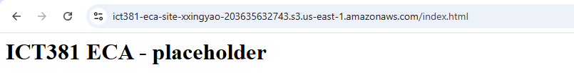

# ICT381 End-of-Course Assessment — July Semester 2026
## Software Engineering and DevOps

| | |
|---|---|
| **Name** | Lau Xing Yao |
| **SUSS PI No.** | B2411711 |
| **Course** | ICT381 Software Engineering and DevOps |
| **Submission date** | 08 November 2026 |
| **Repository** | https://github.com/ICT381/ict381-2026-t02-eca-xxingyao |

### Repository layout

```
/
├── frontend/              React application
├── backend/               Flask API + tests
├── infra/
│   ├── terraform/         Infrastructure as code (Q2)
│   ├── ansible/           Deploy playbooks (Q3b)
│   └── local-ansible/     CI host bootstrap (Q3a)
├── Jenkinsfile            Multibranch pipeline (Q4)
├── evidence/              Run logs and screenshots, by question
└── README.md              This file
```

### Marker's index

| Question | Topic | Marks | Evidence section |
|---|---|---|---|
| 1 | Monorepo migration | 5 | [Q1](#question-1--monorepo-migration) |
| 2a | Terraform authoring | 13 | [Q2a](#question-2a--work-out-and-author-the-terraform) |
| 2b | Terraform run evidence | 6 | [Q2b](#question-2b--run-it-and-capture-the-evidence) |
| 2c | Reflection: current → target | 6 | [Q2c](#question-2c--reflection-current-to-target) |
| 3a | Bootstrap the CI host | 8 | [Q3a](#question-3a--bootstrap-the-ci-host) |
| 3b | Deploy playbooks | 13 | [Q3b](#question-3b--fill-in-and-run-the-two-deploy-playbooks) |
| 3c | Idempotency | 4 | [Q3c](#question-3c--idempotency) |
| 4a | The test gate | 7 | [Q4a](#question-4a--the-test-gate) |
| 4b | Build the release pipeline | 14 | [Q4b](#question-4b--build-the-release-pipeline) |
| 4c | Activate and run the pipeline | 4 | [Q4c](#question-4c--activate-and-run-the-pipeline) |
| 4d | Reflection: the test gate | 3 | [Q4d](#question-4d--reflection) |
| 5 | Operate: reasoning about rollback | 8 | [Q5](#question-5--operate-reasoning-about-rollback) |
| 6 | Reflection: what the monorepo resolved | 9 | [Q6](#question-6--what-the-monorepo-resolved) |

---

# Question 1 — Monorepo migration

**(5 marks)**

### 1. The migrated monorepo

The three codebases were relocated into a single repository:

| Was | Now |
|---|---|
| `myReactApp` (separate repo) | `/frontend` |
| `StaycationX` (separate repo) | `/backend` |
| `automation` (separate repo) | `/infra` |

### 2. Pull request

**PR URL:** `https://github.com/ICT381/ict381-2026-t02-eca-xxingyao/pull/2`

The PR diff is the before/after for items 3 and 4 below.

### 3. Jenkinsfile before/after

Three separate checkouts collapsed into a single monorepo checkout, and stage commands repointed to `/infra`.

| Stage | Before | After |
|---|---|---|
| Checkout | 3 × `git` clone (automation, StaycationX, myReactApp) | `checkout scm` |
| Docker | `ansible-playbook ansible/build-docker.yaml` | `ansible-playbook infra/ansible/build-docker.yaml` |
| Terraform | `terraform -chdir=terraform ...` | `terraform -chdir=infra/terraform ...` |
| Ansible | `ansible-playbook ... ansible/prod-application.yaml` | `ansible-playbook ... infra/ansible/prod-application.yaml` |

### 4. Ansible playbook before/after

| File | Line | Before | After |
|---|---|---|---|
| `infra/ansible/build-docker.yaml` | 35 | `project_src: /opt/StaycationX` | `project_src: /opt/backend` |
| `infra/ansible/build-docker.yaml` | 65 | build context `.../StaycationX/` | build context `.../backend/` (backend image) |
| `infra/ansible/build-docker.yaml` | 79 | build context `.../StaycationX/` | build context `.../backend/` (MongoDB image) |
| `infra/ansible/build-docker.yaml` | 94 | build context `.../myReactApp/` | build context `.../frontend/` |
| `infra/ansible/prod-application.yaml` | 39 | `src: .../StaycationX/dockerhub.yml` | `src: .../backend/dockerhub.yml` |

---

# Question 2 — Infrastructure as code with Terraform

## Question 2a — Work out and author the Terraform

**(13 marks)**

All resources are in [`infra/terraform/main.tf`](infra/terraform/main.tf); the outputs are in [`infra/terraform/output.tf`](infra/terraform/output.tf).

### 1. Committed Terraform configuration

| Resource | File / line | Notes |
|---|---|---|
| CI EC2 instance | `main.tf`, line 152 | `aws_instance.jenkins`, group `jenkins`, `ci_sg` |
| Application EC2 instance | `main.tf`, line 169 | `aws_instance.app`, group `web`, `application_sg` |
| Database EC2 instance | `main.tf`, line 186 | `aws_instance.db`, `database_sg`, no Elastic IP. The default subnet gives it a public IPv4 for outbound traffic only (ECR pulls, apt); inbound is limited by `database_sg` |
| Elastic IP — CI host | `main.tf`, line 206 | `aws_eip.jenkins_eip` |
| Elastic IP — application host | `main.tf`, line 211 | `aws_eip.app_eip` |
| S3 static-website bucket | `main.tf`, line 221 | `awscc_s3_bucket.site` (see note below). Website config line 225, public-access block line 237, public-read policy line 245 |
| ECR repository — backend | `main.tf`, line 263 | `ict381_backend` |
| ECR repository — MongoDB | `main.tf`, line 269 | `ict381_mongo` |

**Why the bucket uses `awscc_s3_bucket`.** The `aws_s3_bucket` resource reads the bucket's Object Lock configuration (`s3:GetBucketObjectLockConfiguration`) after creating it, and the AWS Academy Learner Lab denies that read through a service control policy. The bucket is therefore created with `awscc_s3_bucket` from the `hashicorp/awscc` provider; its website configuration, public-access block and public-read policy are ordinary `aws` provider resources.

### 2. Remote-state backend

S3 backend with `use_lockfile` (Terraform ≥ 1.10), not local state.

- **File:** `main.tf`, lines 1–19 (`backend "s3"` at line 13, `use_lockfile = true` at line 17)
- **State bucket:** `ict381-eca-tfstate-xxingyao-203635632743-us-east-1-an` (created in the AWS Console before `terraform init`)

### 3. Security-group rules enforcing the boundaries

| Boundary | Rule | File / line |
|---|---|---|
| MongoDB 27017 from application SG only | `from_port 27017`, source `application_sg` | `main.tf`, lines 125 and 128 |
| SSH to application host from CI SG only | `from_port 22`, source `ci_sg` | `main.tf`, lines 103 and 106 |
| SSH to database host from CI SG only | `from_port 22`, source `ci_sg` | `main.tf`, lines 132 and 135 |
| Jenkins 8080 from GitHub webhook ranges only | GitHub `hooks` ranges from `api.github.com/meta` | `main.tf`, line 62; IPv4 lines 65–73, IPv6 lines 74–77 |
| Backend API 5000 inbound from internet | `from_port 5000`, `0.0.0.0/0` | `main.tf`, lines 96 and 99 |

The old shared security group (22, 80, 5000, 27017, 8080, 9000 and 3000 open to `0.0.0.0/0`) was removed.

### 4. IAM instance-profile attachments

`iam_instance_profile = "LabInstanceProfile"` on all three hosts — the CI host pushes to S3/ECR through it, and the application and database hosts pull from the private ECR through it.

| Host | File / line |
|---|---|
| CI | `main.tf`, line 157 |
| Application | `main.tf`, line 174 |
| Database | `main.tf`, line 191 |

## Question 2b — Run it and capture the evidence

**(6 marks)**

### 1. Terraform apply output

**Log:** [`evidence/q2b-apply.log`](evidence/q2b-apply.log)

Covers the CI, application and database instances, the Elastic IPs, the S3 website bucket, the private ECR repositories, and the security groups.

### 2. S3 bucket serving the static site

**Screenshot:** [`evidence/q2b-s3-site.png`](evidence/q2b-s3-site.png)



### 3. Terraform output values

**Log:** [`evidence/q2b-output.log`](evidence/q2b-output.log)

| Output | Value | Used by |
|---|---|---|
| `site_website_endpoint` | `ict381-eca-site-xxingyao-203635632743.s3-website-us-east-1.amazonaws.com` | The public site URL |
| `ci_public_ip` | `52.54.76.84` | Q3a SSH, Q4 webhook target |
| `app_public_dns` | `ec2-3-214-100-242.compute-1.amazonaws.com` | Frontend API endpoint |
| `app_private_dns` | `ip-172-31-42-96.ec2.internal` | Ansible/SSH deploy target |
| `site_bucket_name` | `ict381-eca-site-xxingyao-203635632743` | Q4 `aws s3 sync` target |
| `backend_ecr_url` | `203635632743.dkr.ecr.us-east-1.amazonaws.com/ict381_backend` | Q3b/Q4 image pushes |
| `mongo_ecr_url` | `203635632743.dkr.ecr.us-east-1.amazonaws.com/ict381_mongo` | Q3b/Q4 image pushes |
| `db_private_ip` | `172.31.40.21` | Ansible target + backend Mongo endpoint |

## Question 2c — Reflection: current to target

**(6 marks)**

> Analyse the differences between the existing `automation/terraform/` and the target topology. Present each as before → after and explain the value each adds in terms of security, reliability, scalability or maintainability. Explain *why* each change is an improvement, not just what changed.

### Difference 1 — `TODO: title`

| | |
|---|---|
| **Before** | `TODO` |
| **After** | `TODO` |
| **Value added** | `TODO` |
| **Why this is an improvement** | `TODO` |

### Difference 2 — `TODO: title`

| | |
|---|---|
| **Before** | `TODO` |
| **After** | `TODO` |
| **Value added** | `TODO` |
| **Why this is an improvement** | `TODO` |

### Difference 3 — `TODO: title`

`TODO — repeat the structure above. Candidates: two-apply/two-state → one config with one remote state; shared wide-open SG → per-tier least-privilege SGs; 3-in-1 host → isolated tiers; local state → S3 remote state with locking; Docker Hub → private ECR; co-located frontend → S3 static hosting.`

---

# Question 3 — Automation with Ansible

## Question 3a — Bootstrap the CI host

**(8 marks)**

### (a)(i) Major changes from the base `automation/local-ansible/`

> Compare the provided `infra/local-ansible/` against the base `automation/local-ansible/`. Identify the major changes and explain why each was made: what was removed, what was added, and which files were deleted or renamed.

| Change | Type | What changed | Why |
|---|---|---|---|
| `TODO` | Added / Removed / Renamed / Deleted | `TODO` | `TODO` |
| `TODO` | | `TODO` | `TODO` |
| `TODO` | | `TODO` | `TODO` |

### (a) Bootstrap run

**Log:** [`evidence/q3a-bootstrap.log`](evidence/q3a-bootstrap.log) — `ansible-playbook common.yaml jenkins.yaml`

### (a) Bootstrap proof

**Log:** [`evidence/q3a-verify.log`](evidence/q3a-verify.log)

| Check | Result |
|---|---|
| Docker version | `TODO` |
| Ansible version | `TODO` |
| AWS CLI version | `TODO` |
| `labsuser.pem` present on host | `TODO` |
| Jenkins on 8080 (`X-Jenkins` header) | `TODO` |

## Question 3b — Fill in and run the two deploy playbooks

**(13 marks)**

### (b) Completed files

| File | What was filled in |
|---|---|
| `infra/ansible/build-docker.yaml` | Build-and-push tasks in the `YOUR SCRIPT` block |
| `infra/ansible/inventory.ini` | Application and database private addresses; backend and MongoDB ECR repo URLs |
| `infra/ansible/prod-application.yaml` | Host targeting (MongoDB → database host, backend → application host) and the parameterised `image_tag` |

### (b) Run logs

| Log | What it proves |
|---|---|
| [`evidence/q3b-build-push.log`](evidence/q3b-build-push.log) | Images built and pushed to private ECR |
| [`evidence/q3b-ecr-images.log`](evidence/q3b-ecr-images.log) | Both images landed in ECR |
| [`evidence/q3b-deploy.log`](evidence/q3b-deploy.log) | Split deploy ran across both hosts |

### (b) Service verification

**Log:** [`evidence/q3b-verify.log`](evidence/q3b-verify.log)

| Check | Expected | Result |
|---|---|---|
| `docker ps` on database host | MongoDB container running | `TODO` |
| `appUsers` count | Greater than 0 — proves first-start seeding | `TODO` |
| `docker ps` on application host | Backend container running | `TODO` |
| Backend `extra_hosts` mapping | `db` → database host private address | `TODO` |
| Backend log | Connected to MongoDB | `TODO` |
| `curl` application host :5000 | Any HTTP response | `TODO` |

### (b) Question 1 — Why does the backend container need the `db` `extra_hosts` mapping?

> Why does the backend need this in the split deployment, when the original co-located `dockerhub.yml` did not?

`TODO — cover: what hostname app/__init__.py uses for Mongo and whether it can be changed outside FLASK_ENV=development; how the old single-host Compose project resolved the name db; what changed once MongoDB moved to a separate EC2 host.`

### (b) Question 2 — Why is the AWS CLI installed on the application and database hosts?

`TODO — what the setup play uses it for there, and why it must be on those hosts specifically.`

### (b) Question 3 — What each verification command checks

| Command | What it checks | Why it matters for confirming the split deploy |
|---|---|---|
| `docker ps` (database host) | `TODO` | `TODO` |
| `mongosh` appUsers count | `TODO` | `TODO` |
| `docker ps` (application host) | `TODO` | `TODO` |
| `docker inspect` extra_hosts | `TODO` | `TODO` |
| `docker logs` backend | `TODO` | `TODO` |
| `curl` :5000 | `TODO` | `TODO` |

## Question 3c — Idempotency

**(4 marks)**

### (c) Idempotency log

**Log:** [`evidence/q3c-idempotency.log`](evidence/q3c-idempotency.log)

`PLAY RECAP` reports `changed=0` on the second run.

```
TODO — paste the PLAY RECAP line here
```

### (c) Why the idempotent deploy matters

`TODO — ground in: how often Q4's pipeline runs prod-application.yaml (every merge to main); what would happen each run if re-deploying tore down and rebuilt even when nothing changed; what Q5's rollback does with this same playbook.`

---

# Question 4 — Continuous integration and delivery

## Question 4a — The test gate

**(7 marks)**

### (a)(i) Completed test harness

**File:** `backend/test-compose.yml` — every `REPLACE_WITH_...` placeholder resolved.

| Service | Purpose | Key configuration |
|---|---|---|
| `TODO` (db) | Seeded MongoDB from `DockerfileMongo` | Service name matches the Mongo host `create_app()` uses by default |
| `test` | `python:3.12`, backend source mounted | Runs `pip install -r requirements.txt && python -m pytest -vv tests/unit tests/functional` |

### (a)(ii) Both suites run

| Log | Suite |
|---|---|
| [`evidence/q4a-frontend.log`](evidence/q4a-frontend.log) | React suite in `node:16.20.2-alpine` |
| [`evidence/q4a-backend.log`](evidence/q4a-backend.log) | `tests/unit` + `tests/functional` against seeded Mongo |

A failing test here is expected and intentional — the red → green transition is demonstrated in part (c).

### (a) Question 1 — Why does the backend test run need a MongoDB at all?

`TODO`

### (a) Question 2 — Why does the test gate need the database seeded with the staycation data?

`TODO`

### (a) Question 3 — One improvement to the backend testing in this gate

`TODO — ground it in this build, not generic testing advice.`

## Question 4b — Build the release pipeline

**(14 marks)**

### (b) The completed pipeline file

**File:** `Jenkinsfile` — every `REPLACE_WITH_` filled.

| Blank | What it achieves | Value used |
|---|---|---|
| `SITE_BUCKET` | Q2 output — S3 sync target | `TODO` |
| `APP_PUBLIC_DNS` | Q2 output — frontend API base | `TODO` |
| Tag release | `git tag ${RELEASE_TAG}` + push, wrapped in `sshagent(['github-ssh-key'])` | `TODO` |
| Deploy frontend to S3 | `aws s3 sync … --delete --region ${AWS_REGION}` | `TODO` |
| Deploy backend | Build + push `:vN` to ECR, then Ansible with `-e image_tag=${RELEASE_TAG} -e mongo_image_tag=${RELEASE_TAG}` | `TODO` |
| `main`-only guards | `when { branch 'main' }` on the three deploy stages | `TODO` |

### (b) The frontend API base

`REACT_APP_API_URL` change applied across five files:

- [ ] `frontend/src/Components/Form/form.js`
- [ ] `frontend/src/Pages/show.js`
- [ ] `frontend/src/Pages/manage.js`
- [ ] `frontend/src/Pages/explore.js`
- [ ] `frontend/src/Pages/book.js`

### (b) Local development still works

**Screenshot:** `TODO — evidence/q4b-local-dev-network.png`

Shows `npm start` on :3000 loading data from the local `docker compose` backend on `localhost:5000`.

### (b) Write-up 1 — The local-development fix

> The replacement line works for the deployed build but breaks local development. Modify the change so local dev still works while still using the injected value for the deployed build, and explain the approach.

`TODO — state the approach and why it works for both cases.`

### (b) Write-up 2 — The frontend build command explained

```
docker run --rm -e REACT_APP_API_URL=http://${APP_PUBLIC_DNS}:5000 \
  -v "$PWD:/app" -w /app node:16.20.2-alpine sh -c "npm ci && npm run build"
```

| Part | What it does | Why |
|---|---|---|
| `docker run --rm` | `TODO` | `TODO` |
| `-e REACT_APP_API_URL=…` | `TODO` | `TODO` |
| `-v "$PWD:/app"` | `TODO` | `TODO` |
| `-w /app` | `TODO` | `TODO` |
| `node:16.20.2-alpine` | `TODO` | `TODO` |
| `npm ci` | `TODO` | `TODO` |
| `npm run build` | `TODO` | `TODO` |

### (b) Write-up 3 — Why the `main`-only guard is on the deploy stages only

`TODO — why Checkout and the two test stages are deliberately unguarded.`

## Question 4c — Activate and run the pipeline

**(4 marks)**

### (c) The tagged release

**Screenshot:** `TODO — evidence/q4c-github-tags.png`

Release tag pushed: `TODO — vN`

### (c) The live site, logged in end to end

**Screenshot:** `TODO — evidence/q4c-live-site-login.png`

Single screenshot showing all three:
- [ ] Browser address bar with the S3 website URL
- [ ] The "Log In" heading (the Q4 UI change — proves this is *this* pipeline's release, not the Q3b deploy)
- [ ] Network tab: login request to `http://<application_host_public_dns>:5000/...` at **status 200**

### (c) Webhook

**Screenshot:** `TODO — evidence/q4c-webhook.png`

Webhook at `http://<ci_host_public_address>:8080/github-webhook/`, subscribed to Pushes and Pull requests, with a 200 in Recent Deliveries.

### (c) The pipeline stood up

| Screenshot | Shows |
|---|---|
| `TODO — evidence/q4c-job-config.png` | Multibranch job configuration |
| `TODO — evidence/q4c-credentials.png` | `github-ssh-key` and the fine-grained GitHub token |

### (c) The gate is causal — red → green → merge → deploy

| Step | Evidence | Screenshot |
|---|---|---|
| 1. Push with failing test → red build, PR ✗ | `TODO` | `TODO` |
| 2. Fix in a second commit → green, PR ✓ | `TODO` | `TODO` |
| 3. Merge after the green check | `TODO` | `TODO` |
| 4. Gate re-runs on `main`, then deploy stages run | `TODO` | `TODO` |

No red pull request was merged at any point.

### (c) Why the SSH-tunnelled Jenkins access is secure

> You reach the Jenkins UI over an SSH tunnel instead of opening port 8080 to the internet. What makes this access path secure — what protects it, and which attack surface does it remove?

`TODO`

## Question 4d — Reflection

**(3 marks)**

### (d)(a) Against change-scoped testing

> A teammate argues the gate is wasteful: when a PR touches only `/frontend`, run the React suite alone; when it touches only `/backend`, run the backend suite alone. Counter this.

`TODO — give the context and the reasons for running both suites, grounded in this build.`

### (d)(b) Against testing once

> The gate runs the whole suite on every feature-branch push, then again on the `main` build before the deploy stages. Explain why the second run is not redundant.

`TODO`

---

# Question 5 — Operate: reasoning about rollback

**(8 marks)**

> Every mechanism relied on must quote the exact names and values from this repository — the actual identifiers, outputs, commands and files produced in Questions 1–4 — and cite where each is defined.

### Reference: artifacts this rollback relies on

| Artifact | Exact value | Defined in |
|---|---|---|
| Release tag format | `TODO` | `TODO` |
| Backend ECR repository | `TODO` | `TODO` |
| MongoDB ECR repository | `TODO` | `TODO` |
| Site S3 bucket | `TODO` | `TODO` |
| Deploy playbook | `infra/ansible/prod-application.yaml` | `TODO` |
| Image tag parameters | `-e image_tag=` / `-e mongo_image_tag=` | `TODO` |

### (a) Returning each tier to a previous stable version

`TODO — for both frontend and backend: what you check out, rebuild or redeploy, and which Q1–4 artifacts you rely on. Identify where a tier can be restored WITHOUT rebuilding, and explain why that is possible.`

### (b) Keeping the two tiers consistent

`TODO — how you ensure frontend and backend return to the same release together. What property of the way they were built and released guarantees this?`

### (c) Database deployment handling

`TODO — issues with redeploying the database on every release, plus an improvement, grounded in how DockerfileMongo / db_seed_restore.sh seed and prod-application.yaml actually behave.`

### (d) Why the infrastructure stays untouched

`TODO — what separates "what runs" from "what it runs on", and why that separation makes rollback a fast redeploy rather than a rebuild.`

### (e) Detecting it sooner, recovering faster

`TODO — how you would notice the failure faster, shorten recovery, or prevent recurrence.`

---

# Question 6 — What the monorepo resolved

**(9 marks)**

> At least three distinct points. Each must be grounded in concrete cross-repository coordination friction encountered in the TMA (where frontend and backend were separate repos) and linked to a specific artifact from Questions 2–5 that demonstrates how a single repository removed that friction. Make the causal relationship clear.

### Point 1 — `TODO: title`

| | |
|---|---|
| **TMA friction** | `TODO — the concrete coordination problem encountered` |
| **Artifact from Q2–5** | `TODO — the specific file, log or output` |
| **Why the restructuring eliminates it** | `TODO — the causal explanation` |

### Point 2 — `TODO: title`

| | |
|---|---|
| **TMA friction** | `TODO` |
| **Artifact from Q2–5** | `TODO` |
| **Why the restructuring eliminates it** | `TODO` |

### Point 3 — `TODO: title`

| | |
|---|---|
| **TMA friction** | `TODO` |
| **Artifact from Q2–5** | `TODO` |
| **Why the restructuring eliminates it** | `TODO` |

---

## Evidence index

All run logs and screenshots live under `evidence/`.

| File | Question | Status |
|---|---|---|
| `q2b-apply.log` | 2b | ☐ |
| `q2b-output.log` | 2b | ☐ |
| `q2b-s3-site.png` | 2b | ☐ |
| `q3a-bootstrap.log` | 3a | ☐ |
| `q3a-verify.log` | 3a | ☐ |
| `q3b-build-push.log` | 3b | ☐ |
| `q3b-ecr-images.log` | 3b | ☐ |
| `q3b-deploy.log` | 3b | ☐ |
| `q3b-verify.log` | 3b | ☐ |
| `q3c-idempotency.log` | 3c | ☐ |
| `q4a-frontend.log` | 4a | ☐ |
| `q4a-backend.log` | 4a | ☐ |
| `q4b-local-dev-network.png` | 4b | ☐ |
| `q4c-github-tags.png` | 4c | ☐ |
| `q4c-live-site-login.png` | 4c | ☐ |
| `q4c-webhook.png` | 4c | ☐ |
| `q4c-job-config.png` | 4c | ☐ |
| `q4c-credentials.png` | 4c | ☐ |
| `q4c-gate-red.png` | 4c | ☐ |
| `q4c-gate-green.png` | 4c | ☐ |
| `q4c-gate-merge.png` | 4c | ☐ |
| `q4c-gate-deploy.png` | 4c | ☐ |

## Submission checklist

- [ ] Every `TODO` above replaced
- [ ] Every evidence file committed and linked
- [ ] All written answers also pasted into the Canvas report
- [ ] Canvas report includes name, student ID and repository URL
- [ ] Final commit timestamp is before **Sunday 8 November 2026, 12:00 noon**
- [ ] No credentials committed (`.aws/`, `*.pem`, `.env`)